# Hybrid PBR + NPR · URP 混合渲染

Unity 6 (URP 17) 里的一条混合渲染管线：场景用标准 PBR，角色用自研的 NPR 着色，两边共享同一套光照。

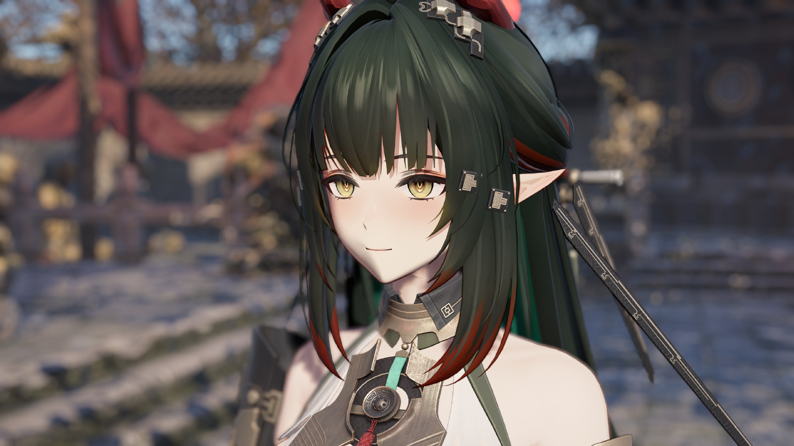

> 个人技术作品集项目。角色是《明日方舟：终末地》庄方宜的同人模型（借物：鹰角网络），场景是第三方资产包 Asian Dynasty Environment（BefourStudios）。仓库只含原创的着色器、渲染代码、工具和配置，以及注明来源的移植代码，**不含模型、贴图、场景文件或任何第三方资产**。画面的权利归原权利人，详见 [NOTICE](NOTICE.md)。

## English summary

A hybrid renderer on Unity 6 / URP 17: the environment is standard PBR (URP Lit, APV probe GI, cascaded shadows, reflection probes), the character uses custom NPR shaders (ramp diffuse, SDF face shadow, Kajiya-Kay hair, screen-space rim and outline), and both read the same light, shadow, GI and AO. The project's focus is the seam between the two: a stylised character tends to look pasted onto a physically lit scene. I measured where that came from (exposure, shadow brightness, highlights that ignored the key light, material frequency) and closed it with light-driven character terms, an exposure split, and framing. Custom RenderGraph passes add GTAO and contact shadows (ported from IllusionRP/HDRP), volumetric fog, a screen-space outline and SSR. With the model and the environment pack in place, the scene, materials and renders are rebuilt from Editor scripts; every effect can be switched off for an A/B comparison, the character terms have debug views, and the screen-space passes have measured GPU costs (the whole frame takes about 7 ms of GPU time at 1080p on an RTX 5060, in Editor Play mode). The repository holds the shaders, C#, settings and tools; the Unity project, models and scene assets are not included.

## 项目在做什么

参考《终末地》《鸣潮》这类作品，我想在 Unity 里做一个"写实场景 + 风格化角色"的画面，而且要求角色真的处在场景的光里：太阳转一圈，角色的明暗、高光、轮廓光都要跟着变。

技术上的约束是尽量用 URP 内置的东西（Lit 材质、APV、级联阴影、后处理），只在内置功能做不到的地方写自定义 pass。角色这边则完全自己写：4 个受光 shader 共用一套光照函数，另有一个无光照的表情叠加层。

做到一半发现最难的不是某个效果，而是两边接不上：同一个画面里，场景是物理光照，角色是另一套审美。下面先讲这个问题怎么解决，再讲各个模块。文中的 v4、v5 是两轮画面迭代：v4 把角色校准到官方原画，并让高光跟随主光；v5 处理角色和场景的融合。

<table>
<tr>
<td width="50%">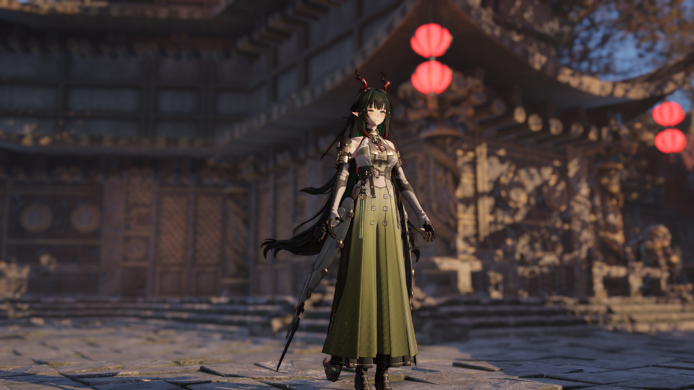</td>
<td width="50%">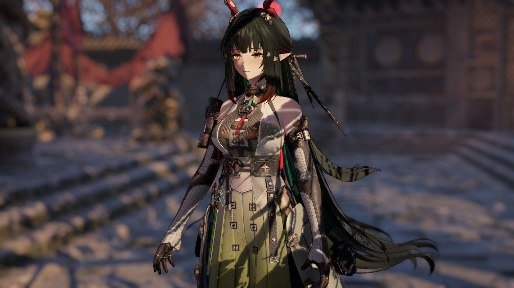</td>
</tr>
<tr>
<td width="50%">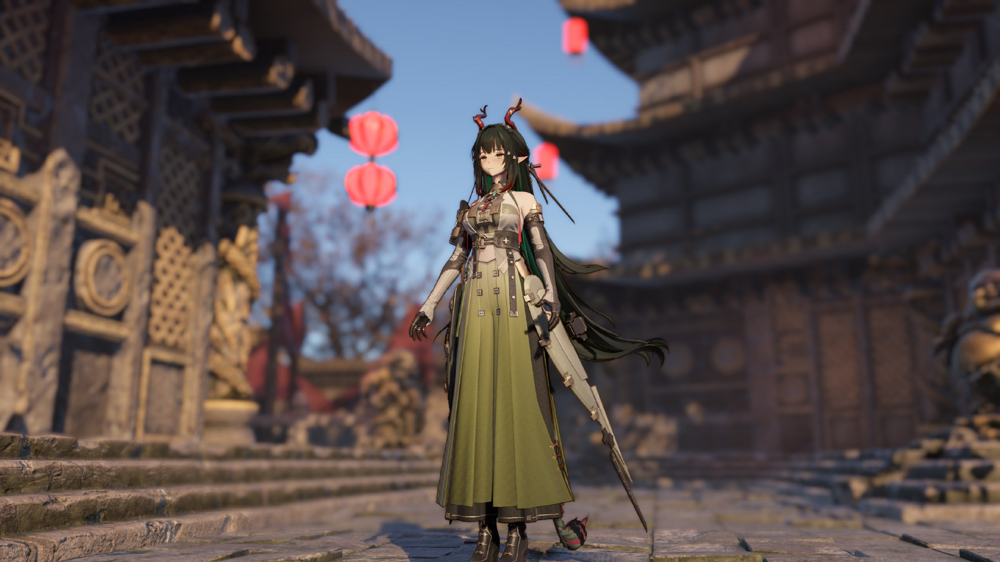</td>
<td width="50%">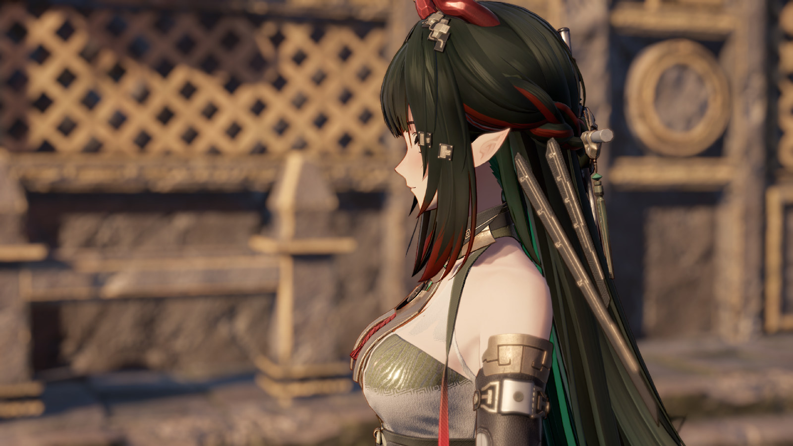</td>
</tr>
</table>

## 让 NPR 角色活在 PBR 场景的光里

### 先看问题

角色调到和官方原画接近之后，放进场景看，问题很明显：

- 五个光照预设之间，场景亮度最多差 3 倍，角色几乎不变。
- 主光绕角色转一圈，胸甲上的反射始终停在同一个位置，看起来像贴上去的。
- 全身镜头里，角色比周围亮，暗部也比旁边环境的暗部亮，干净的 NPR 表面和高频的石木细节互相冲突。

### 原因和做法

我把问题拆开，一项一项找原因，每项都用全局权重控制（0 = 关闭），可以单独做对照：

| 现象 | 原因 | 做法 |
|---|---|---|
| 高光不跟光走 | 金属没有漫反射，烘焙的反射探针就是它的全部外观；Fresnel rim 是固定白色 | 金属保留一部分 ramp 漫反射；反射探针按主光可见度缩放（阴影里 15%，受光处 60%）；rim 改用主光的颜色和阴影 |
| 头发在哪个预设下都一样 | 头发主要靠压平过的探针 GI 照亮 | 直射光占比提高，GI 降低 |
| 角色比场景亮 | 角色单独曝光（为了在太阳 2.6 下不过曝） | 角色在屏幕上的总增益不变，把曝光份额让给场景：角色 0.72→0.62，场景 +0.55→+0.77 EV，背景亮了 1.16 倍，皮肤色值几乎不动 |
| 暗部像自发光 | 暗部提亮（shadow lift）给多了 | 0.12→0.06，暗部跟着环境走 |
| 角色和背景"两层皮" | 材质频率差：写实的高频细节对平整的 NPR 着色 | 全身镜头加 f/4 景深；新增一个树影光照预设，让树冠的影子同时落在地面和角色身上 |

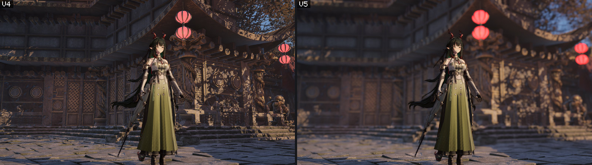

### 怎么验证

光看几张静帧容易自我欺骗，所以每次改动都用同一套方法检查：

- **主光扫描**：同一机位，主光从左、正面到右扫过，检查明暗、头发高光、金属反射和轮廓光是否跟着变化。
- **同镜头对照**：每个版本的基线截图都存下来，改动后用像素差分比较。庭院的树叶会随风动，所以只看角色区域的差异。
- **色值探针**：对着官方原画，在相同位置的小块区域里比较 sRGB 均值，而不是凭眼睛判断曝光。例如特写的亮部皮肤，v5 是 236/214/200，原画约 234/215/202。

<table>
<tr>
<td width="50%">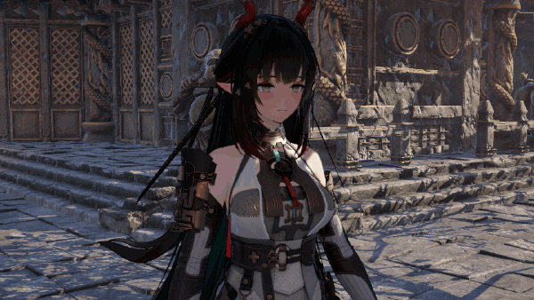<br><sub>主光从左扫到右：明暗、头发高光和金属反射都跟着光走。</sub></td>
<td width="50%">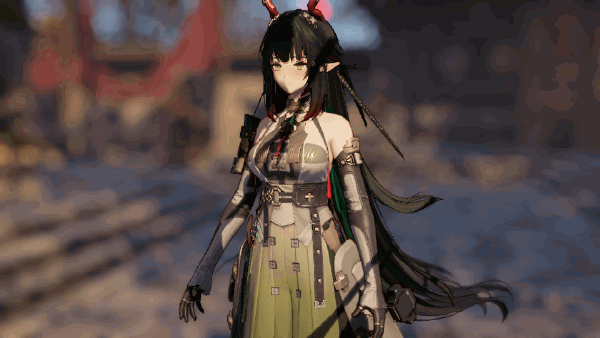<br><sub>太阳高度从 40° 降到 18°，场景和角色一起变暖变暗。</sub></td>
</tr>
</table>

## 管线结构

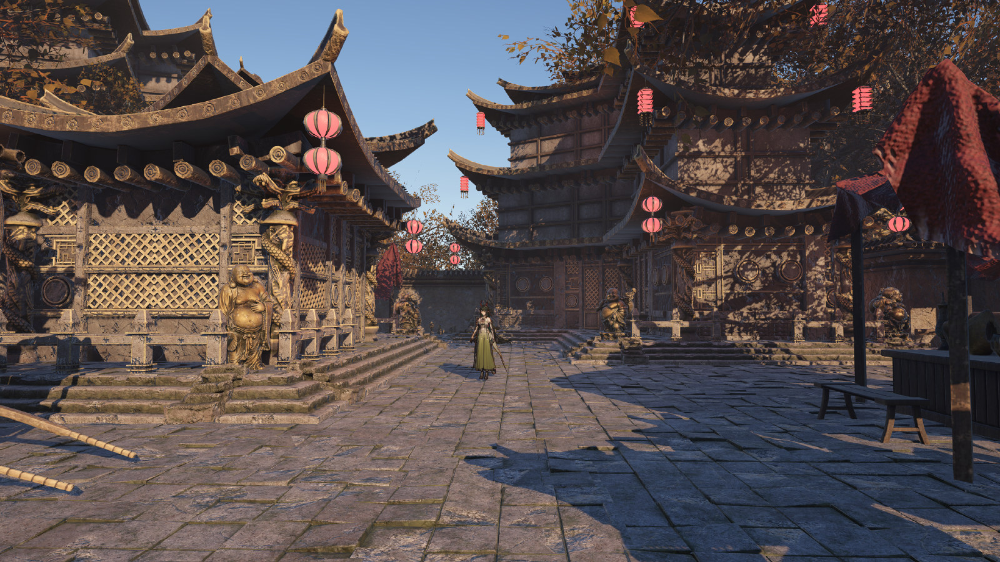

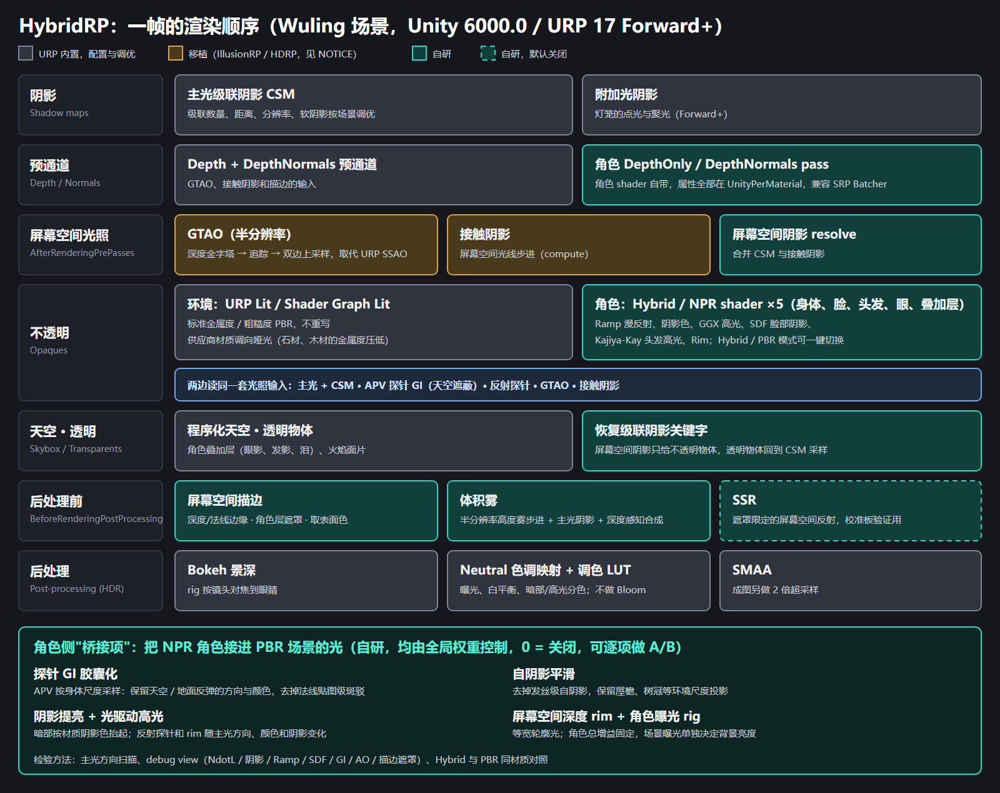

灰色是 URP 内置、我配置和调优的部分，黄色是移植的部分，绿色是自研的部分（[SVG 版本](docs/images/pipeline_overview.svg)）。

| 类别 | 内容 |
|---|---|
| URP 内置，配置和调优 | Forward+、级联阴影、APV 探针 GI（含天空遮蔽）、反射探针、URP Lit / Shader Graph Lit、Bokeh 景深、Neutral 色调映射和调色、SMAA |
| 移植 | GTAO（IllusionRP / HDRP，模糊部分来自 MiniEngine）、接触阴影的 compute（IllusionRP / HDRP） |
| 自研 | 5 个角色 shader 及其全部光照项、屏幕空间阴影 resolve、体积雾、SSR、屏幕空间描边、角色桥接项、截图与对比工具、场景和材质的构建脚本 |

所有自定义 pass 都在一个 `ScriptableRendererFeature` 里，用 URP 17 的 RenderGraph 录制（`RecordRenderGraph`），参数通过 Volume 组件调节。

## 角色着色

身体、脸、头发、眼睛 4 个受光 shader 共用 [`HybridCharacterCommon.hlsl`](Assets/HybridRP/Shaders/Include/HybridCharacterCommon.hlsl) 和 [`HybridCharacterLighting.hlsl`](Assets/HybridRP/Shaders/Include/HybridCharacterLighting.hlsl)，读的是和场景相同的 URP 光照输入：主光与附加光、级联阴影、APV 探针、反射探针、GTAO 和雾。第 5 个是无光照的表情叠加层（眼影、发影、腮红、泪），用正片叠底叠在脸上，跟着脸的明暗走。

- **Ramp 漫反射和阴影色**：半兰伯特和阴影衰减取较小值后查 ramp，阴影区按材质的阴影色染色，不直接压黑。
- **SDF 脸部阴影**：把光照方向投影到头部的水平面上算出阈值，对 SDF 贴图做 smoothstep。脸部的几何项只作为乘子，不再二次进入 ramp，避免脸颊上出现硬线（[`HybridFacePass.hlsl`](Assets/HybridRP/Shaders/Include/HybridFacePass.hlsl)）。
- **Kajiya-Kay 头发高光**：沿头部经线方向的切线，按发丝噪声偏移，分成两个高光瓣：细的主高光带受发丝遮罩控制，宽的次高光用头发自身的颜色。
- **屏幕空间深度 rim**：沿视空间法线方向偏移几个像素采样深度，根据深度差判断是否在轮廓上，得到宽度均匀的轮廓光。线宽按 1080p 的像素数换算，不随分辨率变粗。
- **自阴影平滑**：把阴影图的采样点往光源方向挪一段距离，去掉发丝级的自遮挡，屋檐、树冠这类大尺度投影保留。脸和眼睛取头部统一的阴影值，脸部明暗只由 SDF 决定。
- **探针 GI 胶囊化**：按身体尺度采样 APV，保留天空和地面反弹的方向与颜色，去掉法线贴图带来的斑驳。

```hlsl
// HybridCharacterCommon.hlsl —— 反射探针跟随主光：探针图像保留（金属的质感靠它），
// 但在角色自己的阴影里降到 15%，受光处 60%，形状交给跟随主光的 GGX 高光。
half HybridReflectionLightScale(half keyLit)
{
    if (_HybridShadingMode != 0)
        return 1.0h;
    return lerp(1.0h, lerp(0.15h, 0.6h, saturate(keyLit)), (half)saturate(_HybridHighlightLightDrive));
}
```

<table>
<tr>
<td width="50%">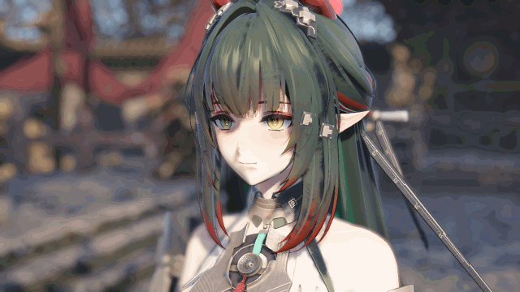<br><sub>同一场景、同一套材质，只切换角色桥接项：曝光 rig、光驱动高光、自阴影平滑、暗部提亮和屏幕空间 rim。</sub></td>
<td width="50%">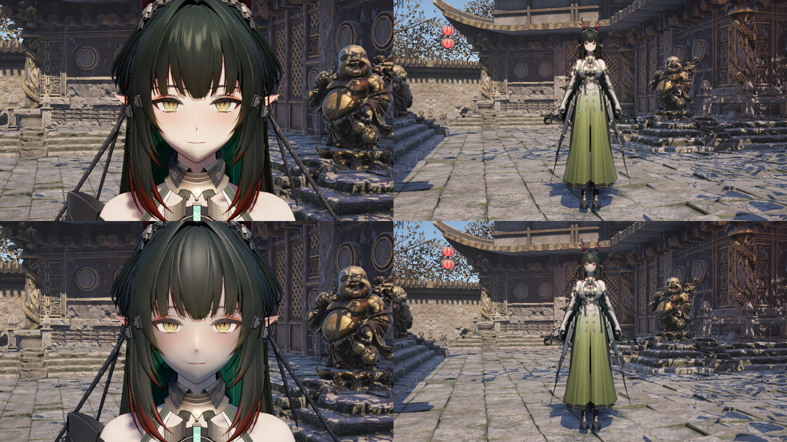<br><sub>上：Hybrid 着色；下：同一套材质切到 PBR 模式。管线其余部分不变。</sub></td>
</tr>
</table>

一个全局整数切换 11 种调试视图：反照率、法线、N·L、阴影衰减、ramp、SDF、高光、rim、GI、AO、描边遮罩（下图第一格是正常画面）。它是 uniform 分支，不增加 shader 变体。

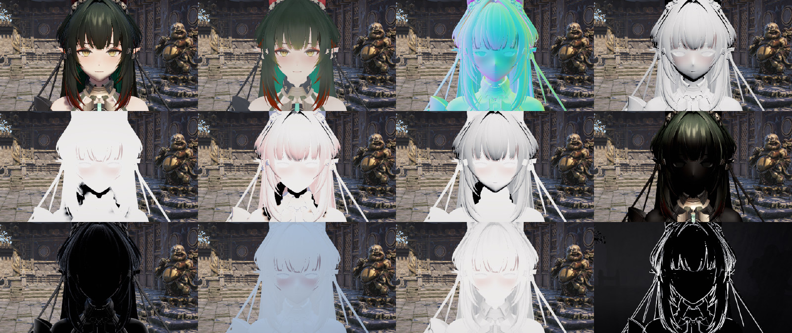

## 屏幕空间效果

| 效果 | 来源 | 做法 | 1080p 耗时 |
|---|---|---|---|
| GTAO | 移植 | 半分辨率，深度金字塔 → 水平角搜索 → 双边上采样；替代 URP SSAO，写入同一个全局纹理，所以场景和角色都能读到 | 0.33 ms |
| 接触阴影 | 移植 + 自研 | 朝主光方向做屏幕空间步进（compute），再和级联阴影合并成屏幕空间阴影（自研 resolve） | 0.19–0.27 ms |
| 体积雾 | 自研 | 半分辨率高度雾步进，采样主光阴影，深度感知合成 | 0.26–0.27 ms |
| 描边 | 自研 | 深度和法线边缘检测；角色单独画一张遮罩，只描角色；线条颜色取表面颜色压暗，而不是统一黑色 | 0.03–0.19 ms |
| SSR | 自研（默认关闭） | 遮罩限定的屏幕空间反射，用于校准板验证 | 0.33–0.57 ms（早期在另一个测试场景的校准板上测得） |

耗时是编辑器 Play 模式下的 GPU 中位数（RTX 5060，1920×1080，四个镜头），不是发行版数据。整帧约 7 ms。描边的耗时随角色在画面中的大小变化。

<table>
<tr><td>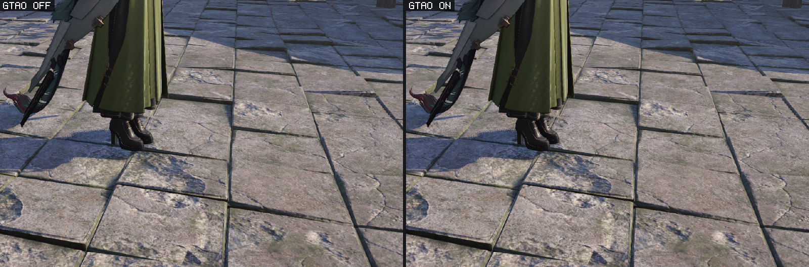</td></tr>
<tr><td>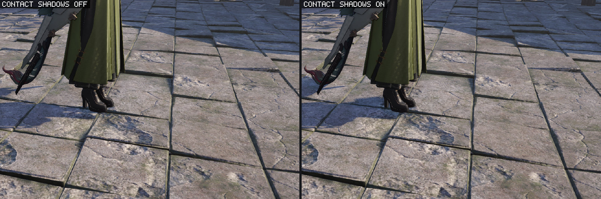</td></tr>
<tr><td>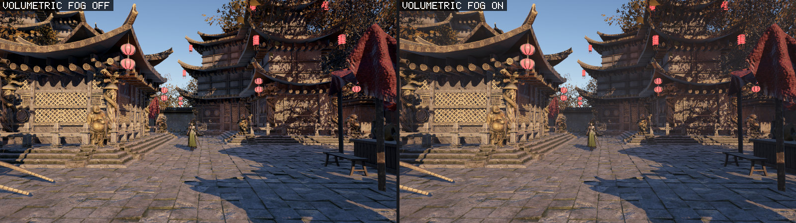</td></tr>
<tr><td>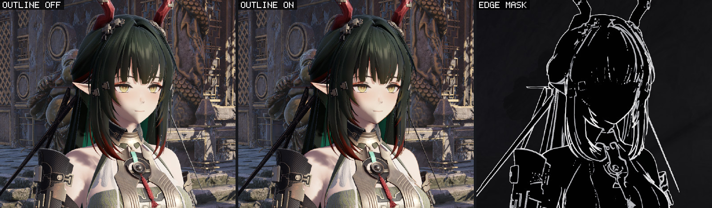</td></tr>
</table>

```csharp
// HybridOutlinePass.cs —— 角色遮罩：只绘制角色渲染层上的不透明物体，
// 复用解析后的相机深度，被遮挡的角色片元不会写进遮罩。
var filtering = new FilteringSettings(RenderQueueRange.opaque, -1, HybridRenderFeature.CharacterRenderingLayer);
var renderers = renderGraph.CreateRendererList(new RendererListParams(renderingData.cullResults, drawing, filtering));
using (var builder = renderGraph.AddRasterRenderPass<MaskData>("Hybrid Outline Mask", out var data, MaskSampler))
{
    data.renderers = renderers;
    builder.UseRendererList(renderers);
    builder.UseTexture(resources.cameraDepthTexture, AccessFlags.Read);
    builder.SetRenderAttachment(mask, 0, AccessFlags.Write);
    builder.SetRenderFunc(static (MaskData pass, RasterGraphContext context) =>
        context.cmd.DrawRendererList(pass.renderers));
}
```

## 可复现的工作流

场景、材质和画面都由 Editor 脚本生成，不手改 `.unity` / `.asset`。只要角色模型和场景资产包在工程里，重跑脚本（加上一次 APV 烘焙）就能回到同一个状态：

- [`WulingShowcaseSetup`](Assets/HybridRP/Editor/WulingShowcaseSetup.cs)：从供应商的演示地图复制出展示场景，摆放角色和姿势，配置镜头书签、光照预设、Volume、APV，并把供应商材质调成哑光。
- [`CharacterShaderSetup`](Assets/HybridRP/Editor/CharacterShaderSetup.cs)：生成 36 个角色材质，把所有调好的数值写在代码里。
- [`HybridCapture`](Assets/HybridRP/Editor/HybridCapture.cs) / [`ShowcaseRig`](Assets/HybridRP/Runtime/ShowcaseRig.cs)：按"镜头书签 × 光照预设"截图（渲染到半精度 HDR 目标，避免色调映射前被 8 位截断），可拼成对照表，或对两张图做像素差分。
- [`PerfProbe`](Assets/HybridRP/Editor/PerfProbe.cs)：在 Play 模式下按 pass 统计 GPU 耗时，带有效性检查（帧是否推进、样本数是否足够、读数是否重复）。
- [`Tools/portfolio/`](Tools/portfolio)：参数 A/B 渲染、2 倍超采样加景深合成、冻结植被风动后的 GIF 序列和效果对照、GIF 编码器。
- [`Tools/ue.sh`](Tools/ue.sh)：通过 Unity CLI 在打开的编辑器里执行 C#，以上工作基本都靠它驱动。

## 我做了什么

- 设计整条混合管线：决定哪些用 URP 内置、哪些自己写，所有自定义 pass 用 RenderGraph 实现。
- 写了 5 个角色 shader 及其光照模型，以及描边、体积雾、SSR、屏幕空间阴影 resolve；移植并精简了 GTAO 和接触阴影。
- 诊断并解决角色和场景的融合问题，用主光扫描、同镜头差分和色值探针验证每一步。
- 写了全部 Editor 构建脚本、截图和性能工具，让场景、材质和成图都能从代码复现。

项目由我个人完成。代码编写、脚本自动化和文档整理借助了 AI 编程助手，技术路线、画面判断、实验设计、结果验证和验收由我负责。

## 没做到的部分

- **远景描边过重**：描边是固定像素宽，角色在远处时头发和裙摆会被勾成一圈深色轮廓。下一步是按深度衰减线宽和强度。

  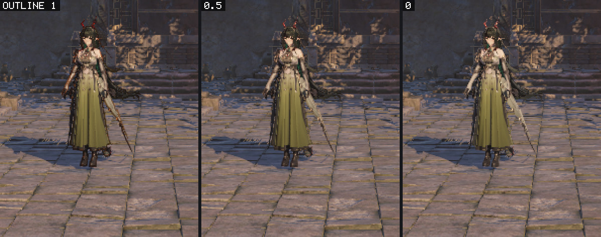

- **角色单独曝光**：这是有意的取舍（类似过场动画给角色单独打灯），但意味着角色并不是物理正确地处在场景曝光下。v5 缩小了亮度差，没有消除。
- **材质频率差异**：靠景深和镜头规避，环境材质本身没有做风格化。
- **头部阴影只取一个值**：树影下脸要么全亮要么全暗，树叶被风吹动时会在两者之间跳。这是为了让 SDF 单独决定脸部明暗而做的取舍。
- **SSR**：半透明水面不写深度，SSR 只在校准板上验证过，默认关闭。

## 仓库内容

```
Assets/HybridRP/
  Shaders/Character/   5 个角色 shader（4 个受光 + 1 个表情叠加层）
  Shaders/Include/     共享的光照、输入和 pass 代码
  Shaders/Compute/     GTAO、深度金字塔、接触阴影、体积雾、SSR
  Shaders/PostFX/      描边、屏幕空间阴影、雾和 SSR 的合成
  Runtime/             RendererFeature、各个 RenderGraph pass、Volume 组件、角色驱动、镜头 rig
  Editor/              场景和材质构建、截图、性能统计、对照工具
Assets/Settings/       URP 资产、Renderer、Volume Profile
Assets/Scenes/Wuling/  展示场景的调色、大气和镜头 Profile（场景文件本身不含）
Tools/                 编辑器驱动脚本、拼图工具、成图与 GIF 工具
docs/images/           本页用到的图片
LICENSES/              移植和改编代码的原许可文本
```

仓库不能直接打开运行：角色模型和场景资产都不在里面。要复现，需要 Unity 6000.0.83f1 和 URP 17.0.4，把 `Assets/HybridRP` 和 `Assets/Settings` 放进工程，再自行准备角色（按 [`TextureImportRules`](Assets/HybridRP/Editor/TextureImportRules.cs) 里的贴图约定）和场景。`Tools/pmx2fbx.py` 是 PMX 转 FBX 的 Blender 脚本。

## 许可

原创代码、着色器、工具和文档以 MIT 发布，见 [LICENSE](LICENSE)。移植和改编的代码（GTAO、接触阴影、SDF 角度阈值）保留原许可（Unity Companion License、MIT），见 [NOTICE](NOTICE.md) 和 [LICENSES/](LICENSES)。角色、场景和截图中的画面不在 MIT 范围内。
